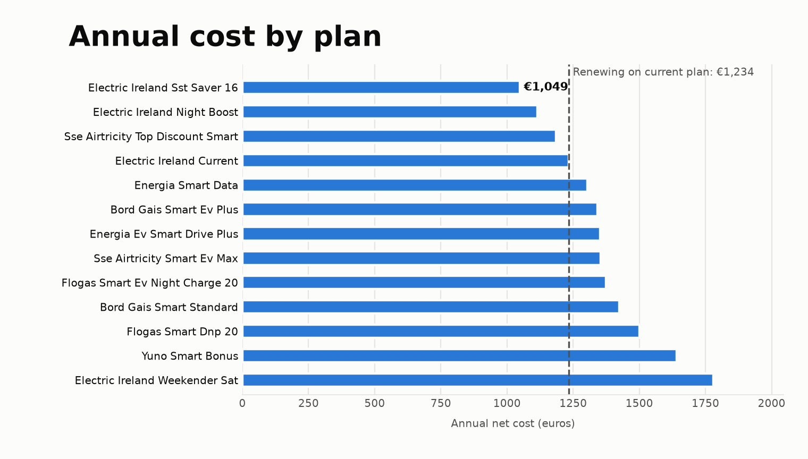

# Home Energy Tariff Model
 
An initial Python model that replays a household's half-hourly smart meter data under a variety of candidate Irish electricity tariffs to find the cheapest plan for a home that has solar panels, a battery and an electric vehicle.
 
## Purpose
 
Irish electricity plans can differ widely, both in price and in conditions. Rates change by time of day and day of the week, export rates vary, and payment terms differ (for example, a credit on the bill versus a payment that may have tax implications). A household’s demand, solar panels, battery and EV mileage can all have a big effect on which plan is cheapest. This makes a “standard” comparison misleading, because what matters is not just how much electricity is imported but when, and how much is produced, stored and exported. Supplier comparison tools work from average usage profiles. This project prices the household’s actual half-hours instead, including time-of-use bands, weekday-only peaks, discounts, standing charges, levies and export credit.
 
## Initial household result
 
Replaying 12 months of real data (Nov 2025 to Oct 2026) under 13 plans, the cheapest in the base case is Electric Ireland Home Electric+ SST Saver 16% at about €1,049 a year. Renewing on the current plan's 5.5% discount costs about €1,234, so the saving is roughly €185 a year (about 15%). The ranking holds under a naive ±20% change in usage and export.
 
It is worth noting that the 16% is a headline new customer rate, so it is an upper bound on what a retention call might achieve. Staying on the SST plan would need a discount of about 12% to match Electric Ireland Night Boost (also advertised to new customers only) and about 8% to match the best outside offer (SSE Airtricity Top Discount Smart).

 
## How it works
 
1. Load and clean ESB smart meter data noting time zones, clock changes and interval start times
2. Tariffs are defined in `config/system.yaml` with time-of-use bands, weekday-only peaks, discounts and levies
3. Price every half-hour, add standing charge, PSO levy and VAT, then subtract export credit
4. Validate by reproducing a real monthly bill from raw readings (`tests/`)
5. Replay 12 months under every plan, then run basic sensitivity and break-even analysis

## Current oversights and future plans
In the near future I would like to:
 
- Make the standing charge configurable, as it is currently fixed to the rural smart rate
- Include one-off discounts such as welcome bonuses, which are currently left out because they are not relevant to the decision
- Use my own inverter data in the modelling
- Check whether that data is available to the average household and, if it is hard to get, work out what is most realistic
- Allow changes to usage, such as adding a new car
- Treat solar production as a stochastic process
- Treat "optimal usage" as a stochastic process, so that if a plan has an ultra cheap rate, expected usage adjusts accordingly
- Compare against current comparison websites
- Compare against a naive "pick the cheapest" approach
- Define a complete list of assumptions
- Handle credit that is paid out as a payment rather than applied as an account credit, which may have tax implications